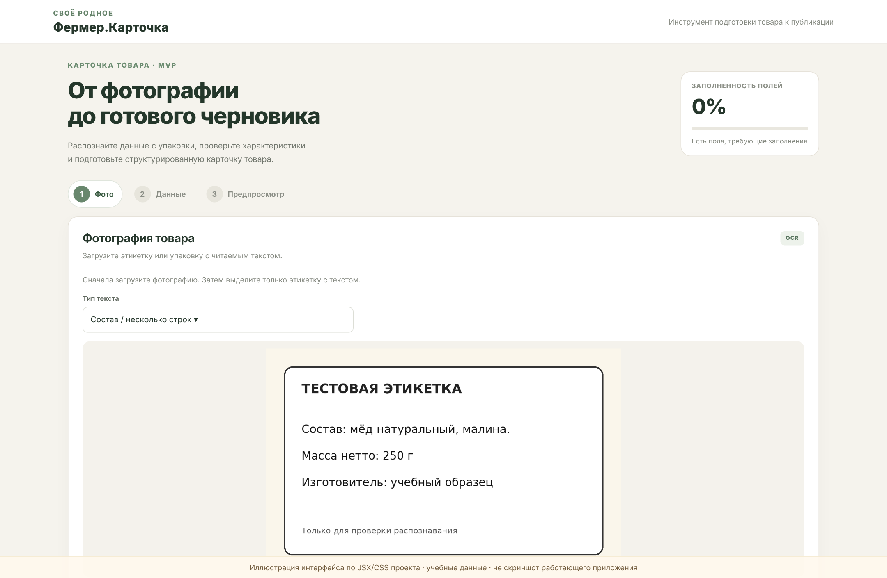
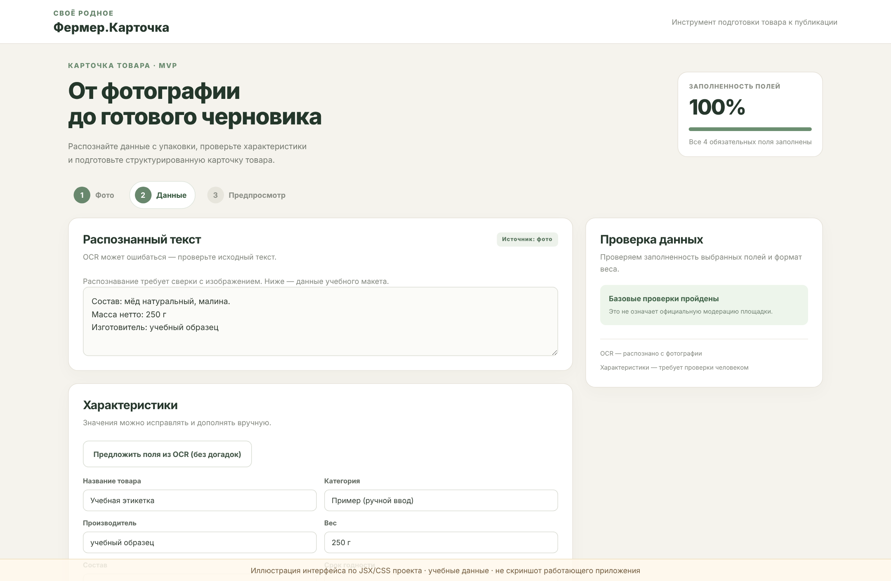

# Фермер.Карточка 🌿

**От фотографии упаковки — к проверяемому черновику товарной карточки.**

Учебный MVP по кейсу «Карточка товара за три минуты». Реализовано браузерное приложение React + Vite с русскоязычным OCR (`Tesseract.js`, языковой пакет `rus`), редактированием данных, оценкой заполненности и экспортом JSON. Неизвестные характеристики приложение не выдумывает.

> Целевой UX — подготовка черновика за 3 минуты; это **цель сценария, не результат тайминг-тестирования**. Результат OCR требует проверки человеком.

## Демонстрация

1. Перейдите на шаг **«Фото»**, загрузите изображение этикетки, выделите область текста и выберите режим «Состав» или «Название».
2. Нажмите **«Распознать текст»**. После обработки просмотрите текст и показатель уверенности. Если надёжный текст не найден, система не заполнит поля шумом.
3. На шаге **«Данные»** исправьте OCR, предложите поля из подписанных строк («Состав», «Изготовитель», масса) или введите характеристики вручную.
4. Проверьте замечания и счётчик заполненности. На шаге **«Предпросмотр»** подтвердите сверку данных с упаковкой и экспортируйте JSON.

Для воспроизводимого теста используйте `examples/TEST_russian_composition.png` — **синтетический макет с обычным печатным русским текстом**.

## Запуск на Windows

Требуется Node.js 22 (или совместимая поддерживаемая версия).

```powershell
cd farmer-card
npm.cmd ci
npm.cmd run dev
```

После запуска откройте локальный адрес Vite (обычно `http://localhost:5173/`). `npm.cmd` используется для обхода PowerShell-блокировки `npm.ps1` **без изменения политики безопасности**. Для первого получения модели `rus` нужен доступ к интернету.

## Качество и тестирование

```powershell
npm.cmd test
npm.cmd run lint
npm.cmd run build
```

Проверки охватывают подавление шумового OCR и запрет выдуманных фактов, извлечение явных полей, валидатор и формирование описания. Наличие тестов **не означает подтверждённой точности OCR на всех упаковках**. Стилизованные надписи могут требовать ручного ввода.

## Возможности MVP

| Есть сейчас | Следующий этап |
| --- | --- |
| 1 фото, выделение текста, 2 режима OCR | Несколько фото, автоматический анализ качества |
| 3 прохода OCR, фильтрация шумовых строк | Нейросетевое OCR для декоративных шрифтов |
| Ручное редактирование и подтверждение | История правок, роли, аудит |
| Четыре обязательных поля, оценка заполненности | Категорийные обязательные характеристики |
| Базовая предварительная проверка, JSON-экспорт | Интеграция с маркетплейсами, серверный API |
| `localStorage` для черновика (без фото) | Серверное хранение и безопасная загрузка фото |

**Оценка готовности:** 25 баллов за каждое из полей «Название», «Производитель», «Вес», «Состав», минус 5 баллов при неверном формате массы. Это индикатор **заполненности**, не официальная модерация.

**Без выдуманных фактов:** название, регион, срок годности и категорию нельзя восстановить из неочевидного OCR. Поля состава / изготовителя / массы предлагаются только по явным подписи или единице измерения; результат всегда редактируется человеком.

## Внешний вид учебного сценария





*Иллюстрации с учебными данными, воспроизведённые по JSX/CSS проекта; это не скриншоты реального запуска. Подробнее: `docs/ui-illustrations/README.md`.*

## Архитектура и документация

- `src/App.jsx` — три шага интерфейса и управление черновиком.
- `src/logic/ocrEngine.js` — предобработка, фильтр текста и оценка попыток OCR.
- `src/logic/cardEngine.js` — извлечение явно подписанных полей, валидация, показатель заполненности, описание.
- `docs/CASE_SOLUTION.md` — краткая защита решения по пунктам кейса.
- `docs/API_CONTRACT.md` — **предлагаемый** REST API (в MVP серверного API нет).
- `docs/QA.md` — воспроизводимые проверки и ограничения.
- `.github/workflows/deploy-pages.yml` — CI и публикация статического фронтенда на GitHub Pages.

## Опубликовать код и демо на GitHub

Создайте пустой публичный репозиторий `farmer-card` без автоматического README, затем в корневой папке этого проекта выполните:

```powershell
git init
git add .
git commit -m "case study: farmer card MVP"
git branch -M main
git remote add origin https://github.com/USERNAME/farmer-card.git
git push -u origin main
```

Замените `USERNAME` вашим GitHub-логином. Затем в GitHub откройте **Settings → Pages → Build and deployment → Source: GitHub Actions**. Workflow выполнит установку зависимостей, тесты, линтинг и сборку. После успешной публикации ожидаемый адрес демо: `https://USERNAME.github.io/farmer-card/`. **Адрес не существует, пока вы не опубликовали репозиторий и workflow не завершился успешно.**

## Ограничения

- Предварительная модерация только локальная (обязательные поля и формат веса), не интеграция с официальными правилами площадки.
- Точность OCR зависит от ракурса, освещённости и шрифта; сохранение реального текста важнее агрессивной автозамены.
- Изображение не сохраняется в `localStorage` и после перезагрузки его нужно выбрать снова.
- Нет реализованного backend, классификатора категории, облачного хранения или real-time интеграции.
